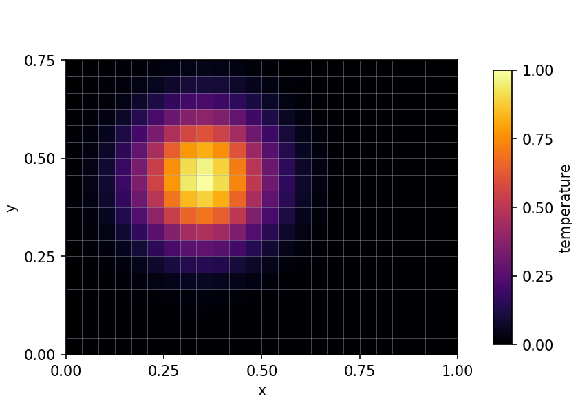
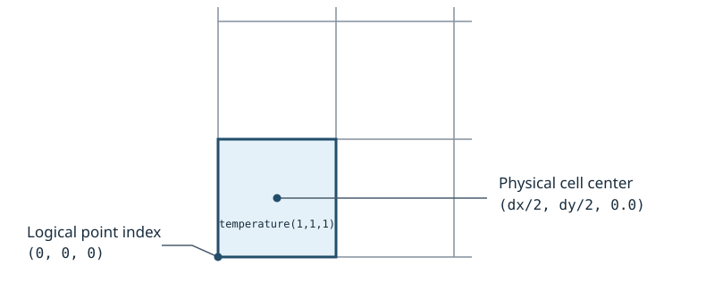

An fVTKHDF Tutorial
===================

In this tutorial, we'll write several small Fortran programs step by step
to create VTKHDF files with different dataset types. After each exercise,
we'll compile and run the program, then open the resulting file in
ParaView to inspect what we wrote. The exercises cover a basic selection of
dataset types and writer features, and each includes a complete Fortran
program.
The :repo:`example directory <example/README.md>` shows additional features
in complete programs, and the :doc:`reference manual <reference>`
describes the available dataset types and writer interfaces in detail.

To build the programs, you’ll need CMake 3.28 or newer, an installed
MPI-enabled fVTKHDF library, and the compatible C, Fortran, MPI, and
parallel HDF5 environment used to build it. You’ll also need a version of
ParaView that supports the VTKHDF datasets in the exercises. See the
:doc:`installation` for how to build and install the library and
:ref:`using-fvtkhdf` for how to build your tutorial programs.

Temperature on a regular grid
-----------------------------

We’ll write a temperature field on a regular two-dimensional grid and view
it in ParaView. We’ll start with one MPI process to get the file-writing
sequence working for a single snapshot. Then we’ll make the hot spot move
and distribute the same grid across two processes. We’ll finish by writing
temperature at the grid points and assigning the shared points to one rank.

   The first exercise places a hot spot above and left of the center of the grid.

ImageData is a natural fit for this regular grid because its geometry
is defined by point bounds, an origin, and uniform spacing along each
axis. We’ll use the ``vtkhdf_image_file_type`` module and declare a
``vtkhdf_image_file`` object for the output.

.. code-block:: fortran

   use vtkhdf_image_file_type
   type(vtkhdf_image_file) :: file

Write a static temperature field
~~~~~~~~~~~~~~~~~~~~~~~~~~~~~~~~

We'll start by writing a single snapshot of the temperature at the cell
centers using one MPI process. Before creating the file, we initialize MPI
and check that ``MPI_COMM_WORLD`` has the expected size.

.. code-block:: fortran

   use mpi

   ! Declarations omitted.

   call MPI_Init(ierr)
   call MPI_Comm_size(MPI_COMM_WORLD, nproc, ierr)
   if (nproc /= 1) then
     call MPI_Finalize(ierr)
     error stop 'Run image_static with exactly 1 MPI process.'
   end if

Our grid covers a 1 by 0.75 rectangle in the z = 0 plane. We use
``nx = 24`` cells along x and ``ny = 18`` cells along y. The physical
origin is ``(0.0, 0.0, 0.0)``, with cell widths ``dx = 1.0/nx`` and
``dy = 0.75/ny``.

We set the inclusive logical point bounds to ``[0,0,0]`` at the lower
corner and ``[nx,ny,0]`` at the upper corner. That gives ``nx+1`` points
along x and ``ny+1`` along y. The lower and upper z bounds are both
0, making this a two-dimensional grid. We retain a singleton third
dimension in the Fortran cell temperature array, which has shape
``(nx,ny,1)``.

We set ``array_origin`` to the global logical index of the first array
element. A cell takes the logical index of its lower corner, the point
with the smaller index along both x and y.

         logical point index (0, 0, 0), and its physical center is at
         (dx/2, dy/2, 0.0).
   :width: 100%

   A close-up of the lower-left corner of the grid.

The half-cell offsets in the loop give the physical coordinates of
each cell center, where we evaluate a Gaussian centered at ``(0.35,0.45)``.

.. literalinclude:: ../../example/tutorial/image_static.F90
   :language: fortran
   :start-at: point_bounds(:,1)
   :end-before: #ifdef USE_MPI

We create the file in static mode with ``MPI_COMM_WORLD``. The call
returns ``stat``, which we check before writing. If creation fails, we
report ``errmsg``.

.. code-block:: fortran

   call file%create('image_static.vtkhdf', MPI_COMM_WORLD, stat, errmsg, mode=VTKHDF_STATIC)
   if (stat /= 0) then
     call MPI_Finalize(ierr)
     error stop errmsg
   end if

We write the mesh once and then write temperature as cell data.
``write_mesh`` takes a three-component spacing vector. We pass ``1.0``
for z as a placeholder because the only logical z index is 0, so the
z spacing has no effect on point coordinates. The writer places the
array using ``array_origin`` and its shape.

.. literalinclude:: ../../example/tutorial/image_static.F90
   :language: fortran
   :start-at: call file%write_mesh
   :end-at: call file%close

The program calls ``MPI_Finalize`` after closing the file. The
:doc:`ImageData <image>` and :doc:`structured writer <structured>`
reference pages describe the mesh and cell-data arguments in detail.

.. raw:: html

   

   
View complete source <code>image_static.F90</code>

.. literalinclude:: ../../example/tutorial/image_static.F90
   :language: fortran

:download:`Download image_static.F90 <../../example/tutorial/image_static.F90>`

.. raw:: html

   

Follow :ref:`using-fvtkhdf`, replacing ``my_app`` with ``image_static``
and using the downloaded
:download:`image_static.F90 <../../example/tutorial/image_static.F90>`
as the source. Include the ``USE_MPI`` target definition so the
preprocessor selects the MPI code. Then run the compiled program as shown
below, assuming the executable is in ``build/`` relative to the working
directory.

.. code-block:: bash

   mpiexec -n 1 ./build/image_static

The run produces ``image_static.vtkhdf`` in the current directory.
Open it in ParaView. The default **Slice** representation can appear
blank. Switch **Representation** to **Surface** or **Surface With Edges**
to show the grid. Color by ``temperature`` and look for the off-center
hot spot shown above.

Write a time-dependent temperature field
~~~~~~~~~~~~~~~~~~~~~~~~~~~~~~~~~~~~~~~~

Now we’ll make the hot spot move by writing a new temperature field at
each time step. We’ll keep the same mesh, array shape, and one-process
MPI setup.

We create ``image_temporal.vtkhdf`` with ``mode=VTKHDF_FIXED_MESH`` and
write the mesh once. Before the first time step, we register ``temperature``.
The real value ``mold=0.0`` specifies the type and kind of the scalar
field. We keep the returned handle in ``temperature_var`` so each step
can write to the registered field.

.. code-block:: fortran

   type(vtkhdf_cell_data_handle) :: temperature_var

.. literalinclude:: ../../example/tutorial/image_temporal.F90
   :language: fortran
   :start-at: temperature_var = file%register
   :end-at: call file%close

The Gaussian starts at the same position as in the static example and
moves along x as time goes from 0 to 1. We start and finalize each time
step around its field write. After the loop, we close the file and
finalize MPI.

.. raw:: html

   

   
View complete source <code>image_temporal.F90</code>

.. literalinclude:: ../../example/tutorial/image_temporal.F90
   :language: fortran

:download:`Download image_temporal.F90 <../../example/tutorial/image_temporal.F90>`

.. raw:: html

   

Build ``image_temporal`` from ``image_temporal.F90``, again
defining ``USE_MPI``.

.. code-block:: bash

   mpiexec -n 1 ./build/image_temporal

Open ``image_temporal.vtkhdf``, choose **Surface** or **Surface With Edges**,
and color by ``temperature``. Play the time series to see the hot spot
move to the right on the fixed grid.

.. figure:: _static/tutorial/temperature-temporal.gif
   :alt: The hot spot moves from left to right across the fixed rectangular grid.
   :width: 65%

   Watch the hot spot move from x = 0.35 to x = 0.70 while the cell edges stay fixed.

.. note::

   To build the first two programs against a serial installation, follow
   the serial instructions in :ref:`using-fvtkhdf` and use
   ``build-serial`` as the build directory. Run the programs directly
   from the project directory.

   .. code-block:: bash

      ./build-serial/image_static
      ./build-serial/image_temporal

   The two-process programs require an MPI-enabled installation.

Distribute the same field across two MPI processes
~~~~~~~~~~~~~~~~~~~~~~~~~~~~~~~~~~~~~~~~~~~~~~~~~~~~

Next we’ll write the same time series to one file using two MPI
processes. The writer calls are collective over ``MPI_COMM_WORLD``, so
both ranks make the same calls in the same order. They supply the same
global mesh description, and each rank supplies its own local field values.

We split the grid into two equal slabs along x and use each process’s
rank in ``MPI_COMM_WORLD`` to decide which slab it writes.
Each rank owns 12 by 18 cells and allocates space for its own slab.

.. figure:: _static/tutorial/cell-slabs.svg
   :alt: Rank 0 owns x cell indices 0 through 11 on the left. Rank 1 owns
         x cell indices 12 through 23 on the right. The slabs meet at x = 0.5.
   :width: 56.25%

Both slabs span the full y range. Each rank sets ``array_origin``
from its rank number and the slab width.

.. literalinclude:: ../../example/tutorial/image_parallel.F90
   :language: fortran
   :start-at: array_origin =
   :end-at: allocate(temperature

After writing the mesh, we fill an integer array of shape
``(local_nx,ny,1)`` with the local MPI rank. Both ranks
write their slab to the static cell array ``mpi_rank`` using the same
``array_origin`` as for temperature. The ownership stays fixed for every
time step, so we write it once before the time loop.

.. literalinclude:: ../../example/tutorial/image_parallel.F90
   :language: fortran
   :start-at: cell_rank = rank
   :end-at: call file%write_cell_data('mpi_rank'

We use the slab’s global starting index when calculating x so both ranks
evaluate the Gaussian at the same physical positions as the one-process
program. For example, rank 1’s ``temperature(1,j,1)`` is centered at
``x = (12 + 0.5)*dx``.

.. literalinclude:: ../../example/tutorial/image_parallel.F90
   :language: fortran
   :start-at: do step = 0, 10
   :end-before: call file%close

Each rank supplies exactly its owned cells, so the array shape and
``array_origin`` are enough to place both slabs without explicit
``write_bounds``. After the last time step, both ranks close the file
and finalize MPI. See the :doc:`common writer conventions <common>`
for collective call requirements.

.. raw:: html

   

   
View complete source <code>image_parallel.F90</code>

.. literalinclude:: ../../example/tutorial/image_parallel.F90
   :language: fortran

:download:`Download image_parallel.F90 <../../example/tutorial/image_parallel.F90>`

.. raw:: html

   

Build ``image_parallel`` from ``image_parallel.F90`` and
launch it with two processes.

.. code-block:: bash

   mpiexec -n 2 ./build/image_parallel

Open ``image_parallel.vtkhdf`` in ParaView, set **Representation** to
**Surface** or **Surface With Edges**, and color by ``mpi_rank``.
Look for rank 0 on the left and rank 1 on the right, meeting at
``x = 0.5``. Switch to ``temperature`` and play the time series.
Check that the grid still spans the 1 by 0.75 rectangle with 24 by 18 cells
and that the hot spot follows the same path across the slab boundary.
Both processes have now written their parts of the same temperature field
into one file.

Write point temperature on two MPI processes
~~~~~~~~~~~~~~~~~~~~~~~~~~~~~~~~~~~~~~~~~~~~~~

This time we’ll write temperature at the grid points, including points
shared by the two slabs. The mesh, the slabs, and the path of the hot
spot stay the same. Each slab is 12 cells wide, so its temperature array
has 13 point columns and 19 point rows, with a singleton z dimension.
The calculation uses point coordinates, so there is no half-cell offset.

The two local arrays both include the point column at logical index 12
(``x = 0.5``). We assign shared points to the lower rank so each global
point is written exactly once.

.. list-table::
   :header-rows: 1

   * - Rank
     - Point columns in local array
     - Point columns written
   * - 0
     - 0–12
     - 0–12
   * - 1
     - 12–24
     - 13–24

We keep ``array_origin`` at the first point stored in each local array.
We start with ``write_bounds`` covering the whole array, then advance
rank 1’s lower x write bound by one to skip its first column. Both
``array_origin`` and ``write_bounds`` use global logical indices.

.. literalinclude:: ../../example/tutorial/image_parallel_points.F90
   :language: fortran
   :start-at: array_origin =
   :end-at: if (rank == 1) write_bounds

To see who wrote each point, we fill a point array with the local MPI
rank and write it once as ``mpi_rank``. We use the same ``write_bounds``
for ``mpi_rank`` and ``temperature``.

.. literalinclude:: ../../example/tutorial/image_parallel_points.F90
   :language: fortran
   :start-at: point_rank = rank
   :end-at: call file%write_point_data('mpi_rank'

We register ``temperature`` as temporal point data, so this version
declares ``temperature_var`` as a point-data handle.

.. code-block:: fortran

   type(vtkhdf_point_data_handle) :: temperature_var

Both ranks follow the same time loop and call ``write_point_data`` with
their own bounds at every step.

.. literalinclude:: ../../example/tutorial/image_parallel_points.F90
   :language: fortran
   :start-at: temperature_var = file%register
   :end-before: call file%close

.. raw:: html

   

   
View complete source <code>image_parallel_points.F90</code>

.. literalinclude:: ../../example/tutorial/image_parallel_points.F90
   :language: fortran

:download:`Download image_parallel_points.F90 <../../example/tutorial/image_parallel_points.F90>`

.. raw:: html

   

Build ``image_parallel_points`` from
``image_parallel_points.F90`` and run it with two processes too.

.. code-block:: bash

   mpiexec -n 2 ./build/image_parallel_points

Open ``image_parallel_points.vtkhdf`` in ParaView. Choose **Points** and
color by ``mpi_rank`` to check that the center column has the same color
as the points on its left. Then switch to **Surface With Edges**, color
by ``temperature``, and watch the hot spot move through the shared
column. Surface coloring interpolates between point values within each
cell.

We’ve written the complete point field at every time step, with rank 0
writing the shared column once per step.
